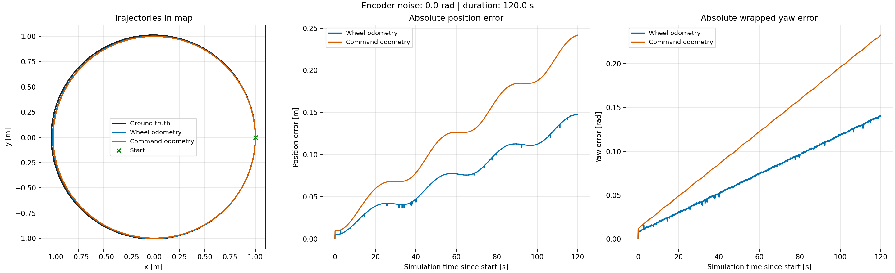
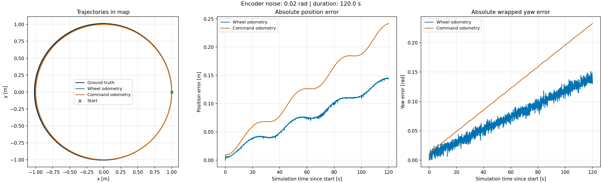
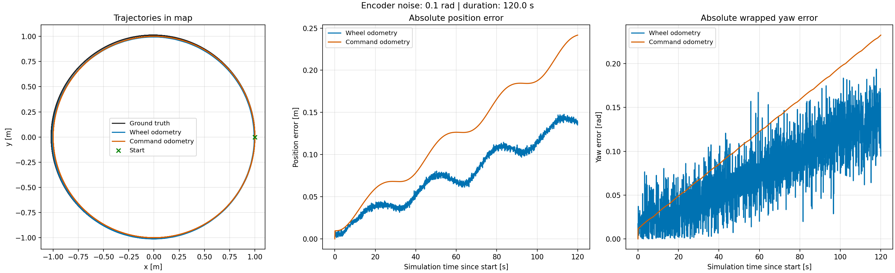

# Практика 3 — одометрия и системы координат

Пакет `practice3_odometry` сравнивает истинную позу TurtleBot3 в Webots, колёсную одометрию и интеграл команд скорости. Один launch запускает сцену, супервизор, контроллеры, команды движения и сборщик. Через заданное время симуляции сохраняются данные и графики, после чего запуск завершается.

## Окружение и сборка

Проверено 4 ноября 2026 года: Ubuntu 24.04 aarch64 в UTM, ROS 2 Jazzy в Docker, Webots R2025a на macOS через локальный simulation server и общую папку. Используется подготовленное окружение курса. Python-зависимости: `numpy`, `matplotlib`, `tf_transformations`; ROS-зависимости перечислены в `package.xml`. Для первоначальной загрузки официальных ресурсов Webots требуется доступ к GitHub; загруженные ресурсы кэшируются Webots.

В ROS-контейнере, в **bash**:

```bash
source /opt/ros/jazzy/setup.bash
cd ~/practices_ws
colcon build --symlink-install --packages-select practice3_odometry
source install/setup.bash
```

Исправление Webots/ROS устанавливается в общем Docker-образе репозитория и применяется ко всем практикам и примерам. Отдельная сборка драйвера внутри практики не требуется. При создании нового окружения сначала собери актуальный Docker-образ по [общей инструкции](../../docker/webots_runtime/README.md), затем выполни обычный `colcon build`.

В **zsh** используй `setup.zsh` вместо `setup.bash` в обеих командах `source`.

Для схемы UTM → Mac сервер симуляции должен быть запущен на Mac до запуска launch. У контейнера должны быть настроены `WEBOTS_SHARED_FOLDER` и адрес `host.docker.internal`, как в инструкции репозитория. Для Linux со своим Webots используется соответствующий вариант окружения курса.

## Запуск трёх опытов

Команды выполняются **по очереди внутри ROS-контейнера**, после подключения собранного окружения. Каждый launch открывает новый мир из одной и той же начальной позы. Отдельно публиковать `/cmd_vel` не нужно.

```bash
ros2 launch practice3_odometry spawn_robot.launch.py \
  encoder_noise:=0 duration:=120 \
  output_dir:=$HOME/practices_ws/src/practice-03/results

ros2 launch practice3_odometry spawn_robot.launch.py \
  encoder_noise:=0.02 duration:=120 \
  output_dir:=$HOME/practices_ws/src/practice-03/results

ros2 launch practice3_odometry spawn_robot.launch.py \
  encoder_noise:=0.1 duration:=120 \
  output_dir:=$HOME/practices_ws/src/practice-03/results
```

Успешное окончание отмечается сообщением `EXPERIMENT COMPLETE: 2401 samples`. Без этого сообщения и нового набора файлов опыт нельзя считать завершённым. Повторный запуск с тем же шумом и каталогом перезапишет соответствующие результаты. Для пробы укажи другой `output_dir` и, например, `duration:=3`.

Параметр `mode:=fast` ускоряет исполнение относительно реальных часов; расчёт по-прежнему использует время симуляции. Сохранённые три опыта выполнены в этом режиме. Для видео оставь стандартный `mode:=realtime`.

| Настройка | Значение во всех трёх опытах |
|---|---|
| Начальная поза в сцене | x = 1 м, y = 0 м, yaw = π/2 |
| Команда | v = 0.2 м/с, ω = 0.2 рад/с, 10 Гц |
| Длительность записи | 120 секунд симуляции, около 3.82 расчётных оборота |
| Шаг выборки | 0.05 с, включая обе границы интервала |
| Шаг физики Webots | 20 мс |
| Контроллер | 50 Гц, радиус колеса 0.033 м, база 0.16 м |
| Поправка базы | `wheel_separation_multiplier: 1.1` |
| Обратная связь | углы энкодеров, `open_loop: false` |
| Seed Webots | 13 |

Уровень шума записан в поле `encoderNoise` экземпляра робота: `my_world.wbt`, `noise_0_02.wbt`, `noise_0_1.wbt`. Три сцены отличаются только этим полем. Launch выбирает нужный файл по `encoder_noise`. Стандартные материалы и лидар в локальном PROTO подключены по официальным ссылкам версии R2025a.

## Как устроены расчёты

`ground_truth.py` получает позу из супервизора и публикует `/clock` и `map → base_link_gt`. Колёсный контроллер публикует `odom → base_link`. Статический `map → odom` совпадает с начальной позой сцены.

`experiment_recorder.py` получает `/clock` и `/cmd_vel`, а `TransformListener` наполняет буфер tf2. Если обе ветки TF доступны на момент первой команды с положительным временем, запись начинается с него. Если ранние TF не попали в буфер, например при быстром старте в `mode:=fast`, сборщик выбирает более новый общий момент: не позже последних доступных TF обеих веток и `/clock − sync_delay`, но не раньше первой команды. Обе позы повторно запрашиваются на эту одну временную метку; отдельные «последние» позы с разным временем не смешиваются. Длительность отсчитывается от выбранного начала, а начальная командная поза копируется из GT **один раз**. Если данные так и не появились, через 90 реальных секунд запуск завершается с причиной последней ошибки TF; это аварийный таймаут, а не длительность эксперимента.

Сборщик запрашивает обе позы в `map` на одну и ту же временную метку. tf2 интерполирует промежуточные значения. Выборка отстаёт от `/clock` на 0.2 секунды симуляции, чтобы сообщения успели прийти; это не входит в записываемую длительность. Все интервалы и граница 120 секунд вычисляются в целых наносекундах. Системные часы используются только для таймаута запуска и даты сохранения файлов. Сброс симуляции во время опыта прерывает запись с ошибкой; новый опыт начинается новым launch.

Командная траектория рассчитывается по модели:

```text
x_dot = v * cos(yaw)
y_dot = v * sin(yaw)
yaw_dot = omega
```

В `odometry.py` используется точное решение на каждом интервале постоянной команды. При смене команды интервал делится по её временной метке. Текущие GT и колёсная одометрия не используются для исправления командной оценки. Это устраняет искусственную погрешность простого шага Эйлера.

Ошибка положения — `hypot(x - gt_x, y - gt_y)`. Ошибка угла — `abs(atan2(sin(yaw - gt_yaw), cos(yaw - gt_yaw)))`; переход через ±π не создаёт ложного скачка.

## Файлы результатов

Для каждого уровня шума сохраняются:

- `noise_*.csv` — все три позы, одинаковые временные метки, команды и четыре ошибки;
- `noise_*_commands.csv` — история полученных команд с временными метками;
- `noise_*.png` — одно изображение с траекториями XY, ошибкой положения и ошибкой yaw;
- `noise_*.json` — параметры записи, начальная поза и RMSE, максимум, последняя ошибка;
- `noise_*.log` — лог проведённого запуска, сохранённый при проверке.

`stamp_ns`, `gt_stamp_ns`, `odom_stamp_ns` в CSV совпадают: это время сравнения поз. `t` — время от начала опыта. Координаты указаны в метрах, углы — в радианах. Командный yaw может выходить за ±π; при сравнении угол корректно нормализуется.

## Результаты

### Шум 0 рад



### Шум 0.02 рад



### Шум 0.1 рад



| Шум, рад | RMSE положения ODOM, м | RMSE положения CMD, м | RMSE yaw ODOM, рад | RMSE yaw CMD, рад |
|---|---|---|---|---|
| 0.0 | 0.08530 | 0.13980 | 0.08353 | 0.13791 |
| 0.02 | 0.08495 | 0.13980 | 0.08325 | 0.13791 |
| 0.1 | 0.08547 | 0.13980 | 0.08612 | 0.13791 |

Даже без шума обе оценки постепенно расходятся с GT: идеальная кинематическая модель не полностью описывает контакт колёс и движение в физическом симуляторе. В этих опытах колёсная оценка точнее командной. Почти совпадающие окружности на XY-графике не означают нулевую ошибку: робот и оценка могут находиться в разных точках близких окружностей в один момент времени.

При повышении шума заметно растёт дрожание колёсной оценки, особенно угла. Максимальная ошибка yaw колёсной оценки увеличилась примерно с 0.1405 до 0.1937 рад. При этом RMSE положения остаётся около 0.085 м: в данной конфигурации систематическое расхождение преобладает над добавленным шумом. Шум не обязан увеличивать каждую отдельную метрику монотонно; например, конечная ошибка может случайно уменьшиться.

Командная траектория и её ошибки практически одинаковы во всех опытах. Команды, физическая сцена и начальная поза одинаковы, а шум добавляется к измерениям энкодеров, которые используются для колёсной оценки. В этих трёх запусках GT также практически совпадает. Это наблюдение для выбранной конфигурации, а не утверждение о любом контроллере и роботе. По одному запуску на уровень шума нельзя оценить статистическую устойчивость результата по разным seed.

## Особенности окружения

Launch использует стандартные `WebotsLauncher` и `WebotsController`. Общий Docker-образ подключает исправленный драйвер и завершение TCP-клиента автоматически; собственных копий этих компонентов в пакете нет.

Исправлены конфликт обработчиков SIGINT, порядок освобождения контроллеров и преждевременное закрытие TCP-клиента. Сначала завершаются драйверы и их потоки, затем закрывается соединение с Webots. Удалён неиспользуемый демонстрационный Python-плагин TurtleBot; параметры движения и одометрии не менялись. Досрочная остановка не выдаёт неполный опыт за успешный и не перезаписывает существующие результаты. Реальные ошибки соединения и зависшие драйверы по-прежнему считаются ошибками.

Проверено 4 ноября: закрытие окна Webots, Ctrl+C, полный опыт на 120 секунд симуляции (2401 строка) и немедленный повторный запуск завершились штатно. Общий драйвер проверен на `example_webots_odometry` и `example_webots` со стандартным `Ros2Supervisor`; журналы находятся локально в `.runtime/validation/common/`. Старые журналы трёх первоначальных опытов в `results/` оставлены без изменений и отражают состояние до исправления завершения.

После исправления старта записи проверены три последовательных полных запуска `mode:=fast`: каждый записал 120 секунд симуляции (2401 точку) за 13–15 реальных секунд вместе со стартом и сохранением графиков. Пройден и короткий запуск `mode:=realtime`. Для новых CSV независимо проверены временные метки и аналитическая командная траектория. Все девять процессов каждого запуска завершились штатно; узел команд теперь откладывает остановку ROS до выхода из текущей обработки сообщения. Проверочные результаты сохранены отдельно в `.runtime/validation/startup-fast/`, исходные результаты для сдачи не перезаписывались.

## Что осталось для сдачи

Код, три опыта и изображения подготовлены. Для сдачи остаются запись видео, публикация ветки, создание PR и отправка формы.

Для видео покажи encoderNoise 0.1 в worlds/noise_0_1.wbt, затем запусти один launch с encoder_noise:=0.1, duration:=120, mode:=realtime. После сообщения EXPERIMENT COMPLETE открой полученный results/noise_0_1.png. Команда, движение и подписи графиков должны быть читаемы. Для просмотра на Mac файлы можно получить из VM через CLion или scp.

PR создаётся из practice-03 в main своего форка. Ветка practice-03 основана на main с общим исправлением Docker/Webots. Сначала нужно опубликовать обновлённый main, затем practice-03: в сравнении этих веток должны отображаться только файлы третьей практики. Настройки IDE и временные файлы в коммиты не включаются. Заголовок PR — ФИО и номер варианта, как требует ТЗ. Merge до проверки преподавателем не делать.
