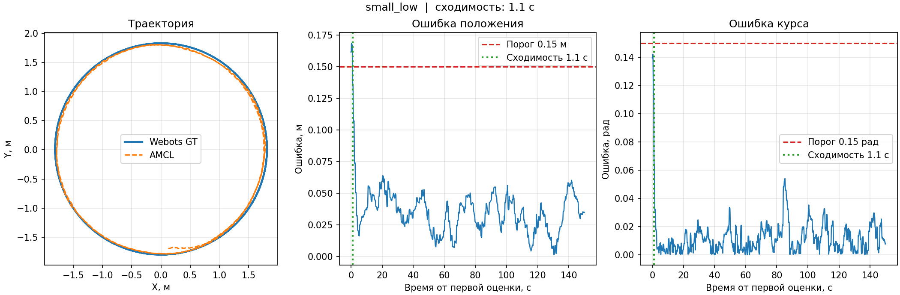
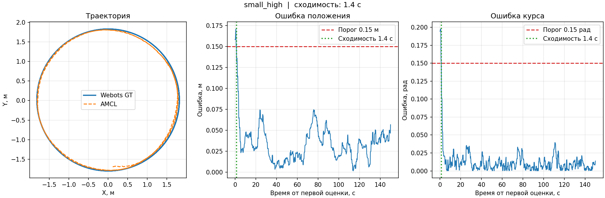
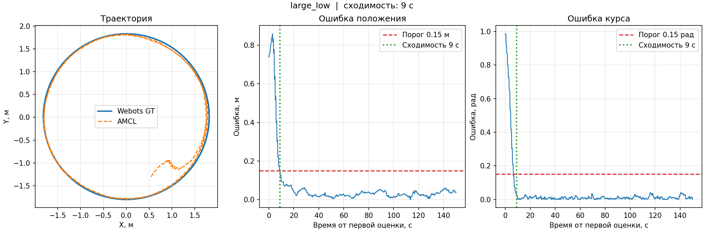
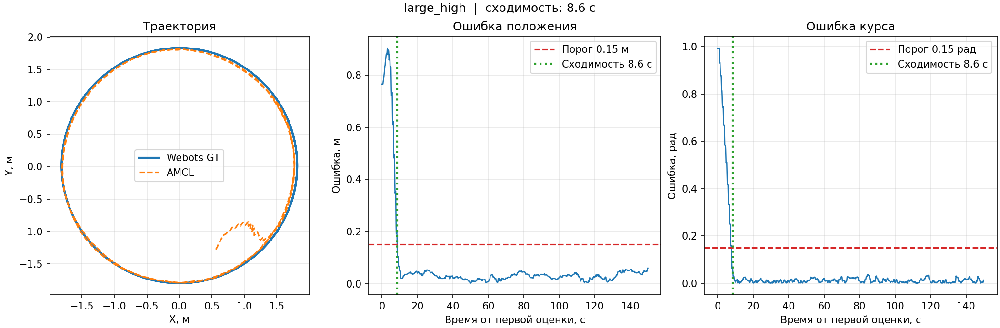
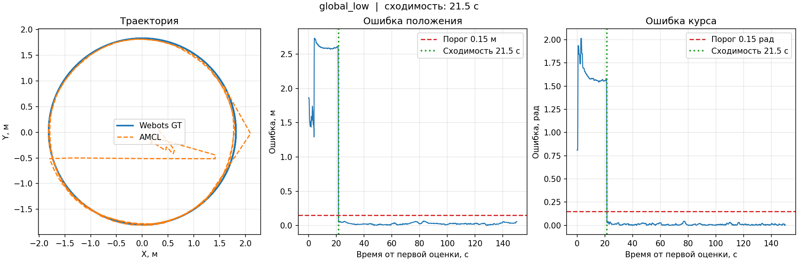
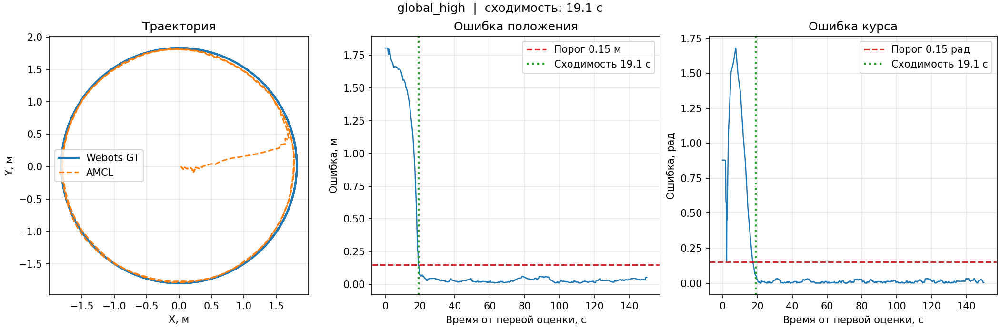

# Практика 4. Локализация по карте, вариант 13

TurtleBot3 едет вокруг цифр 1 и 3. AMCL получает карту, сканы лидара и колёсную одометрию. Супервизор Webots независимо измеряет истинную позу (GT), с которой сравнивается оценка AMCL. Для каждого запуска сохраняются CSV с позами и ошибками, PNG с тремя графиками и JSON со временем сходимости.

## Сборка и запуск

В контейнере курса (ROS 2 Jazzy, zsh):

```zsh
cd ~/practices_ws
source /opt/ros/jazzy/setup.zsh
colcon build --symlink-install --packages-select practice4_localization
source install/setup.zsh
ros2 launch practice4_localization localization.launch.py
```

В конфигурации с Webots на Mac перед запуском должен работать локальный сервер Webots на Mac. По умолчанию открываются Webots и RViz, выполняется опыт с малой начальной ошибкой и малым числом частиц. В RViz включены карта, сканы, облако частиц и оценка AMCL. В рабочем пространстве курса файлы сохраняются в `~/practices_ws/src/practice-04/results`. Повторный запуск заменяет файлы своей комбинации. Чтобы сохранить исходную серию, укажите отдельный каталог через `output_dir:=...`, как в команде для демонстрации ниже.

Шесть команд для воспроизведения серии. Каждая запускает сцену заново и завершается после сохранения результата.

```zsh
ros2 launch practice4_localization localization.launch.py scenario:=small  particles:=low  mode:=fast use_rviz:=false
ros2 launch practice4_localization localization.launch.py scenario:=small  particles:=high mode:=fast use_rviz:=false
ros2 launch practice4_localization localization.launch.py scenario:=large  particles:=low  mode:=fast use_rviz:=false
ros2 launch practice4_localization localization.launch.py scenario:=large  particles:=high mode:=fast use_rviz:=false
ros2 launch practice4_localization localization.launch.py scenario:=global particles:=low  mode:=fast use_rviz:=false
ros2 launch practice4_localization localization.launch.py scenario:=global particles:=high mode:=fast use_rviz:=false
```

Для демонстрации с RViz и отдельным комплектом файлов:

```zsh
ros2 launch practice4_localization localization.launch.py scenario:=large particles:=high \
  mode:=realtime use_rviz:=true keep_open:=true \
  output_dir:=$HOME/practices_ws/src/practice-04/results/video
```

После сообщения «Эксперимент завершён» робот останавливается, а Webots и RViz остаются открытыми. График этого запуска — `results/video/large_high.png`. Завершить launch можно через Ctrl+C в терминале.

## Сцена, карта и настройки

- Площадка 6 × 6 м. Стены толщиной 0,05 м и высотой 0,4 м. Центры цифр из практики 2 находятся в `(−0,6; 0)` и `(0,6; 0)` м. Высота цифр 0,3 м, выше плоскости сканирования.
- В `maps/number_13.pgm` шаг сетки составляет 0,02 м, начало карты в Webots — `(−3,05; −3,05)` м. Карта построена по размерам боксов из PROTO, включая наклонный штрих единицы. Пересоздать PGM и YAML из каталога пакета можно командой `python3 scripts/make_map.py`.
- При наложении 15 сканов на карту по истинной позе 95% из 4 114 отражений оказались в пределах 0,02 м от занятых клеток. По оценке AMCL для тех же отражений это расстояние составило 0,06 м.
- Робот стартует в точке `x = 0 м, y = −1,8 м` с курсом `yaw = 0 рад`, вдоль +X. После первой оценки он получает команды `v = 0,18 м/с`, `ω = 0,10 рад/с` с частотой 10 Гц. Номинальный радиус — 1,8 м. В каждом из шести прогонов по GT робот сделал больше двух оборотов вокруг обеих цифр.
- `small` задаёт смещение от истинной позы `(+0,12 м; +0,10 м; +0,20 рад)`. У `large` оно равно `(+0,55 м; +0,50 м; +1,05 рад)`. В обоих случаях стандартные отклонения начального распределения одинаковы: 0,32 м по X и Y и 0,40 рад по курсу. В режиме `global` AMCL распределяет частицы по свободным клеткам карты.
- Диапазон числа частиц `min_particles … max_particles` составляет **300 … 1 000** для `low` и **300 … 10 000** для `high`. AMCL сам выбирает текущее число в этих пределах. Модель лидара, параметры движения, сцена и критерий сходимости одинаковы.

## Как считается время

За `t₀` берётся метка первой оценки из `/amcl_pose` после инициализации. Обе позы снимаются через TF каждые 0,1 с симуляции. Супервизор публикует `map → base_link_gt`, AMCL поправляет `map → odom`, колёсный контроллер публикует `odom → base_link`. AMCL датирует свою поправку на 0,2 с вперёд. В запросе TF регистратор учитывает этот сдвиг только для поправки, чтобы координаты робота и GT относились к одному моменту.

Ошибка положения равна расстоянию между двумя точками на плоскости. Ошибка курса — модуль кратчайшей угловой разности. После пробных запусков зафиксированы `position_threshold:=0.15` м, `yaw_threshold:=0.15` рад и `hold_time:=5.0` с. Если обе ошибки укладываются в пороги пять секунд подряд, сохраняется начало этого интервала относительно `t₀`. Нарушение любого порога сбрасывает отсчёт. Один опыт длится `duration:=150.0` секунд симуляции.

## Результаты

| Инициализация | До 1 000 частиц | До 10 000 частиц |
|---|---:|---:|
| Малая ошибка | 1,1 с | 1,4 с |
| Большая ошибка | 9,0 с | 8,6 с |
| Глобальный поиск | 21,5 с | 19,1 с |

Малая начальная ошибка дала самое короткое время в обоих режимах. При глобальном поиске роботу пришлось по сканам выбрать место на всей карте: это заняло примерно 19–22 с. Больший лимит частиц сократил время глобального поиска в этой серии на 2,4 с, а при малой ошибке результат оказался на 0,3 с медленнее. Для каждой комбинации выполнен один случайный запуск, поэтому по этим данным нельзя судить о среднем выигрыше от числа частиц.

| Инициализация | До 1 000 частиц | До 10 000 частиц |
|---|---|---|
| Малая ошибка |  |  |
| Большая ошибка |  |  |
| Глобальный поиск |  |  |